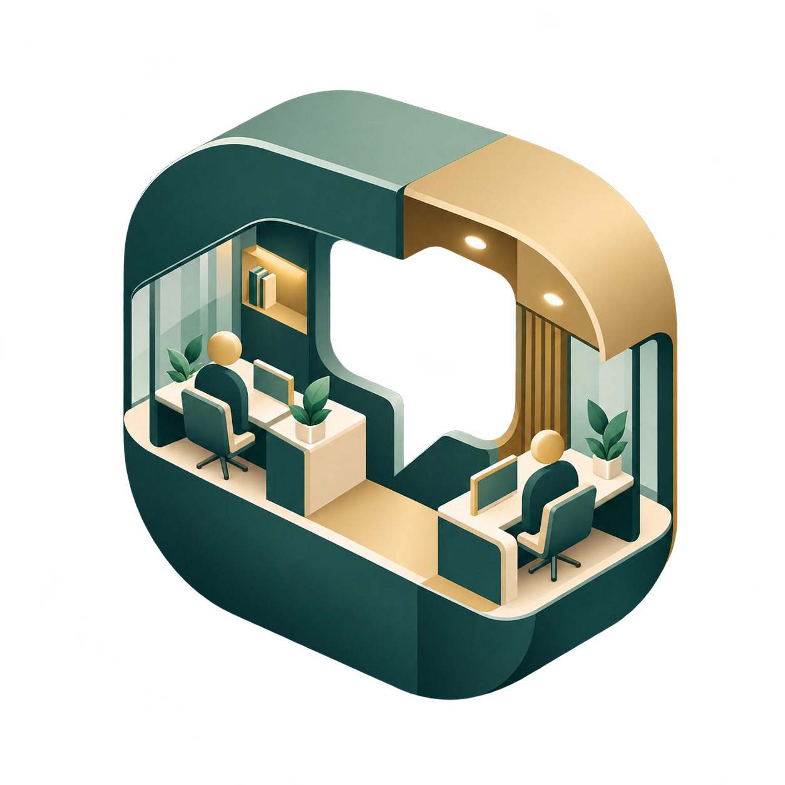
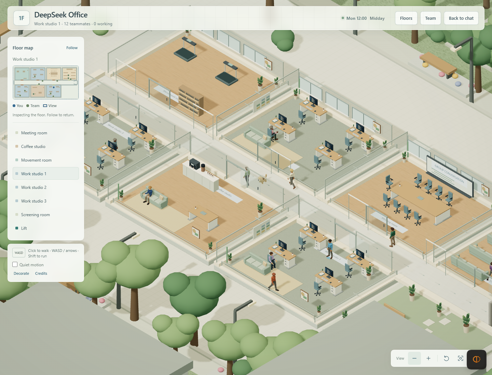
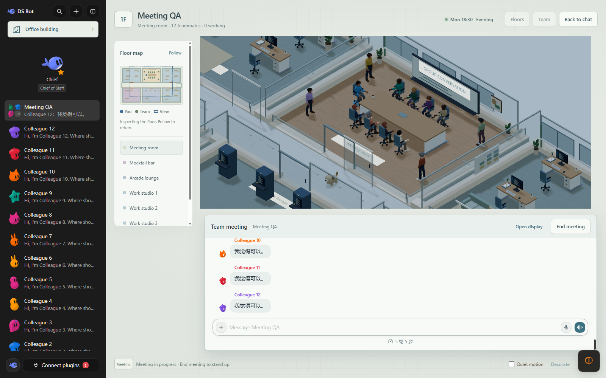
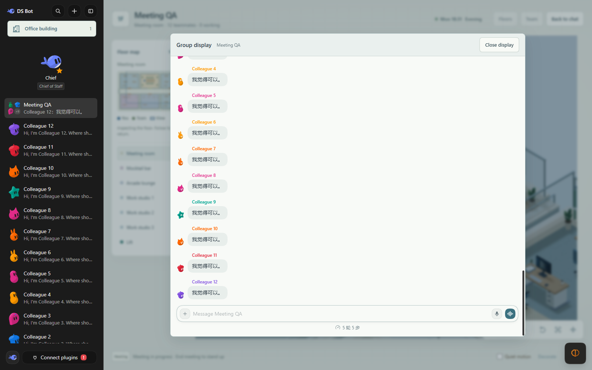
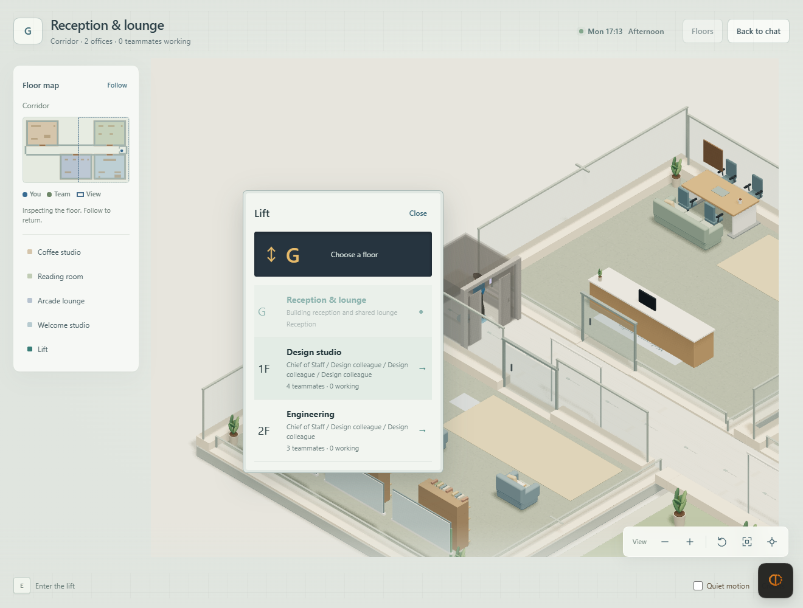
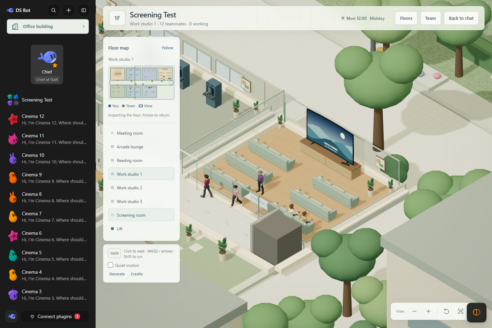
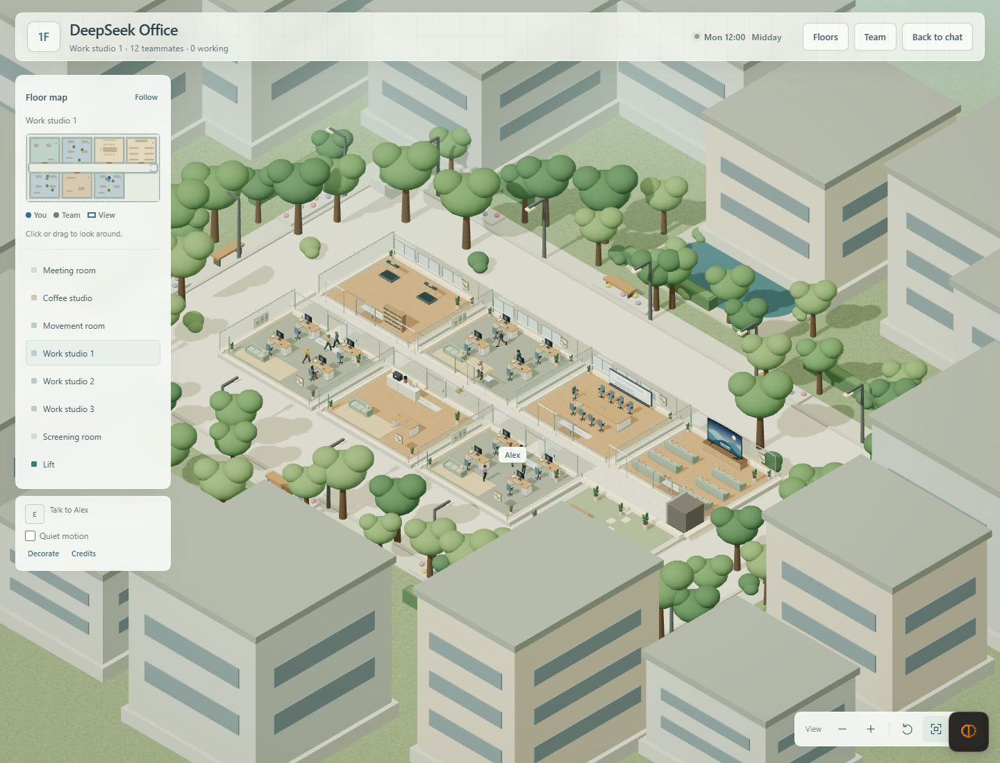

<div align="center">
  
  <h1>DeepSeek Office</h1>
  <p><strong>A place to work, meet and take a break with your AI team.</strong></p>
  <p>A modern 2.5D office simulation for DeepSeek Harness, built on persistent AI teammates and real group conversations.</p>
  <p><strong>English</strong> · <a href="README.zh.md">简体中文</a></p>
  <p><code>v0.7.0</code> · <code>Three.js + Phaser</code> · <code>Apache-2.0 code</code></p>
  <p><a href="#highlights">Highlights</a> · <a href="#screenshots">Screenshots</a> · <a href="#quick-start">Quick start</a> · <a href="#how-to-play">How to play</a> · <a href="#roadmap">Roadmap</a></p>
</div>

<p align="center">
  
</p>
<p align="center"><sub>Actual gameplay from an isolated local test team. Office models and textures are bundled with the plugin.</sub></p>

Create a team, give everyone a role, and walk into its office. Each group chat becomes a floor: coworkers have desks, gather for meetings, share sofas and head off for a coffee. Their work and conversations run through the existing Harness agent system.

DeepSeek Office builds on [DS Bot](https://github.com/Fei2411/DeepSeek-Bot) and uses the public plugin interfaces of [DeepSeek Harness](https://github.com/deepseek-ai/deepseek-harness). Long-lived identities, memory, group collaboration, model settings and permissions remain part of the same team.

## What's new in 0.7.0

- **Warmer rooms**: work studios gain desk pads, stationery, lamps or headphones, cable trays, corkboards and rugs; coffee studios gain cup shelves, bean jars and botanical prints; screening rooms gain acoustic panels, fabric details, wall lights and cabinet vents. These are visual additions within the existing layout, with the existing interface and interaction rules preserved.
- **A phone in the scene**: open private and group chats from anywhere, or read web pages in the phone's Browser app. The phone uses the existing Sessions and native composer.
- **Clearer conversations and navigation**: face-to-face dialogue has illustrated portraits and message-history controls. The upper-right HUD brings together the map, camera controls, floors, team and options; nearby prompts and compact activity cards support keyboard interaction.
- **Updated characters**: the supplied long-haired character model is rigged for the existing idle, walk, sit, drink and exercise animations, with independent appearance colors.

<a id="highlights"></a>
## What makes it interesting

| Experience | What you can do |
|---|---|
| **One group, one floor** | Give different teams their own offices. Each floor keeps its seeded room placement and grows work rooms as members join. |
| **Meetings inside the scene** | Take the head seat, watch coworkers enter in order, and send messages to the real group from the meeting composer. |
| **A team you can recognize** | Coworkers have individual skin, hair, upper garment, lower garment and shoe colors, with walking and seated animations. |
| **Small breaks between tasks** | Brew coffee, turn pages, catch stars at the arcade, prepare lunch, mix a mocktail or follow a stretch rhythm. |
| **A shared screening room** | Six three-person sofas face a large curved TV. People can use separate seats on the same sofa. |
| **An office with a sense of time** | Local time shapes sunlight and evening lighting. Plants, gardens and the surrounding city complete the setting. |
| **Chats and a browser in your pocket** | Use **Phone** or `P` to open private chats, groups and a mobile-style web reader without walking back to a desk. |
| **Your existing AI tools** | Keep private chats, group messages, memory, capabilities, scheduled tasks and usage statistics. Real work takes priority over leisure animations. |

The meeting-room wall display opens the group's complete conversation, including history and live replies. Short speech bubbles show recent messages above the speaker; the chat panel keeps the full text and attachments.

<a id="screenshots"></a>
## A look inside

<table>
  <tr>
    <td width="50%" valign="top">
      <strong>Meet around the same table</strong><br>
      <a href="docs/images/office-meeting.png"></a><br>
      Your head seat, eight member chairs and orderly standing places for the rest of the team.
    </td>
    <td width="50%" valign="top">
      <strong>Keep the whole conversation in view</strong><br>
      <a href="docs/images/office-meeting-display.png"></a><br>
      The wall display and meeting pane reuse the same group chat, history and message input.
    </td>
  </tr>
  <tr>
    <td width="50%" valign="top">
      <strong>Visit another team's floor</strong><br>
      <a href="docs/images/office-elevator.png"></a><br>
      Step into the lift, pick a destination, and travel through a door-and-fade transition.
    </td>
    <td width="50%" valign="top">
      <strong>Save a seat for a break</strong><br>
      <a href="docs/images/office-cinema-shared.png"></a><br>
      Three evenly spaced sofa rows provide 18 seats. The TV currently shows a static cinema illustration.
    </td>
  </tr>
</table>

Screenshots record working development builds; room arrangements vary by group. Click an image for the full view.

<a id="quick-start"></a>
## Quick start

### 1. Prepare Harness

- Install DeepSeek Harness. The development harness is pinned to **`0.2.0-rc.2`**; current office checks use an isolated Web profile on Windows.
- Configure a model for your AI teammates. Chat and optional AI appearance/theme design use those model settings.
- Use a desktop browser or Harness Desktop with WebGL available. **Godot and Blender are not required to run the plugin.**

> This plugin replaces the original `ds-bot` / legacy `dsh-bot` team shell in the selected profile. Disable that plugin before enabling DeepSeek Office, and keep your existing team data.

### 2. Get and install the package

Use the `deepseek-office-0.7.0.tgz` supplied with a build or published release. If a package is not available, build it from this checkout. Source builds need Node.js **22.19 or later** and npm:

```sh
cd ds-bot
npm ci
npm run build
node -e "require('node:fs').mkdirSync('../artifacts', { recursive: true })"
npm pack --pack-destination ../artifacts
```

In **Harness Desktop**, open **Plugins → Add plugin**, enter the package's absolute local path, install and enable it, then restart if prompted. For example:

```text
C:\plugins\deepseek-office-0.7.0.tgz
```

For **Harness Web**, with pnpm available, replace the example with your actual package path:

```sh
npx @deepseek-ai/dsh@0.2.0-rc.2 plugin --profile web add "/absolute/path/deepseek-office-0.7.0.tgz"
npx @deepseek-ai/dsh@0.2.0-rc.2 web
```

<details>
<summary>Installing by package name after npm publication</summary>

The configured npm package name is `deepseek-office`. After an owner publishes it to the selected registry, the add-plugin field can accept `deepseek-office` or a version such as `deepseek-office@0.7.0`. Uploading source to GitHub alone does not publish that npm package. Use the local package if registry publication has not happened.

The plugin lives in the repository's `ds-bot/` subdirectory. A repository URL is therefore not interchangeable with a published package name.

</details>

To update an existing DeepSeek Office installation, use the plugin's Update button. Older DSH profiles install the package for the next restart; newer DSH profiles with hot reload remove the old bundle before installing the new version, preserving its enabled selection. If the replacement fails, the updater attempts to reinstall the previous version. Keep the same profile, `DSH_HOME` and team data.

**Upgrading from 0.6.1 or 0.7.0:** those versions' Update button can report `already-installed` on newer DSH. Use DSH Settings > Plugins to uninstall **DeepSeek Office** and add `deepseek-office` again (or select the new release archive). Remove only the plugin package; keep the team data. This one-time replacement installs the corrected updater. If installation fails after removal, add the previous version from the same Plugins page. With the public CLI, stop that profile first, run `dsh plugin --profile web remove deepseek-office`, then `dsh plugin --profile web add deepseek-office`, and start it again; replace `web` with your actual profile.

The updater is regression-tested with DSH 0.2.0-rc.2 and 0.2.1-rc.2. It uses DSH's public plugin-manager APIs.

### 3. Create your first office

1. Create at least **two AI teammates**, and set their names, roles, instructions and models.
2. Create a group chat and add the teammates. A group supports **2–12 AI members**; you do not count toward that limit.
3. The new group opens its office. **Office building** in the sidebar opens reception; **Floors** lets you visit a group.
4. Walk toward a coworker or facility, or choose someone through **Team**. You can return to the usual conversation with **Back to chat**.

The office entry appears once the team has a group. With no groups, the regular direct-chat experience remains available.

<a id="how-to-play"></a>
## Your first five minutes

### Walk, look around and talk

| Control | Action |
|---|---|
| Click the floor | Walk there using a route around walls and furniture |
| `WASD` / arrow keys | Move in screen directions, including after rotating the camera |
| Hold `Shift` | Run |
| `E` near a person or object | Interact |
| Mouse wheel / zoom buttons | Zoom in or out |
| **Rotate view / Overview** | Rotate the camera or inspect the whole floor |
| Floor map / **Follow** | Inspect a room, then return to following your character |
| **Phone** / `P` | Take out the phone for chats and web pages |
| `Esc` | Close the current panel or put the phone away |
| **More → Quiet motion** | Pause autonomous leisure movement and reduce ambient animation |
| **Back to chat** | Leave the office view and use the ordinary conversation |

### Call a meeting

Walk into **Meeting room** and confirm **Start meeting**. You take the head seat; teammates enter in roster order, fill the member chairs, and stand around the perimeter when those seats are full. Send a message in the lower conversation area exactly as you would in the group chat.

Interact with the wall display or select **Open display** to read the full group history in a centered panel. Choose **End meeting** to stand up and let coworkers resume their routines.

### Take a break or change floors

Approach a sofa or facility and press `E`, or click its nearby interaction prompt. Rest and coffee start directly; activity cards show the relevant controls. Close the activity or move away to resume walking. In **Screening room**, several people can share a sofa's independent seats. Other leisure rooms offer coffee, books, a 30-second star-catching arcade round, lunch, mocktails or stretching, depending on that floor's facilities. You can also greet Momo in the corridor.

Choose **Lift** on the floor map to locate the elevator. Walk inside, read the destination list and select a floor. The cabin closes, the current scene fades, and the destination appears before the doors open.

### Talk face to face or use the phone

Approach a coworker and press `E`, or select them through **Team**. The dialogue panel shows an illustrated portrait, one message at a time, and controls for earlier replies. Choose private chat or a group mention; the native composer keeps attachments, voice, model selection and other conversation tools available.

Click **Phone** below the HUD map or press `P`. Its chat app lists every group and teammate, with search, unread markers and recent-message previews. These conversations use the same Sessions as ordinary chat. The **Browser** app fetches pages through the computer running DSH, using its network and system proxy, and displays them in a sandboxed mobile layout. Pages needing sign-in, forms or complex scripts can be opened in the system browser. Press `Esc` to put the phone away. The player pauses while holding it; the world and agent turns continue.

### Make the team feel like yours

Choose a teammate to inspect or regenerate its appearance. **More → Decorate** adjusts the floor's theme; AI design can propose wall, floor and accent colors. Explicit appearance descriptions can influence the character's palette. Optional AI design makes additional model calls; saved results are reused.

Current 3D characters share the supplied long-haired model with a jacket, skirt and boots. Distinct palettes provide identity; the existing trouser-color channel colors the skirt. Multiple character meshes, furniture placement and room-shape editing are future work. The 3D wardrobe is stored in the current browser.

<a id="floor-layout"></a>
## How floors are arranged

Every group floor includes **one meeting room, one screening room, two seeded leisure facilities and one to three work rooms**. The leisure choices are coffee, reading, arcade, kitchen, mocktail bar and movement. Four employees fit in a work room; members five and nine open additional rooms without moving the existing rooms.

| AI members | Work rooms | Total furnished rooms, including screening |
|---|---:|---:|
| 2–4 | 1 | 5 |
| 5–8 | 2 | 6 |
| 9–12 | 3 | 7 |

The first six room slots are shuffled deterministically from the group ID, so returning to a group preserves its layout. Unused slots become gardens. The screening room occupies the east wing, and the lift sits at the right end of the shared corridor. Reception has its own welcome studio and leisure rooms.

<details>
<summary>See the current full-floor overview</summary>



</details>

<a id="current-scope"></a>
## Current scope

Version **0.7.0** combines the playable office with in-scene phone chat, a mobile-style web reader, face-to-face dialogue and a first decoration pass for work studios, coffee studios and screening rooms. Other leisure facilities keep their existing furnishings. The decoration pass preserves room layouts, paths, seats, interaction targets and the existing UI; group messages, agent work and permissions use the original Harness flow.

The scene currently has **no cross-device multiplayer, cloud-synchronized avatar placement, free-form building editor or management economy**. The screening-room TV has a static display; video playback is not implemented. The 3D view requires WebGL. The in-game phone is a feature of the desktop scene; mobile devices are not the primary target yet.

More on memory, permissions, working folders, models, scheduled tasks and backups: [plugin reference](ds-bot/README.md).

<a id="development"></a>
## Development and verification

```sh
cd ds-bot
npm ci
npm run harness
npm run build
npm test
node scripts/build-client.mjs --check
npm run lint
```

Edit `src/client/` and rebuild; `client.js` is generated and committed. For an isolated preview with mock models and project-local test data, follow [Office development](ds-bot/README.md#office-development). Never use a normal Harness data directory for tests.

| Area | Source or evidence |
|---|---|
| Plugin and host behavior | [`ds-bot/`](ds-bot/) · [plugin reference](ds-bot/README.md) |
| World layout, navigation and simulation | [`src/shared/office/`](ds-bot/src/shared/office/) |
| 2.5D rendering and interface | [`src/client/office/`](ds-bot/src/client/office/) · [rendering checks](docs/office-25d-verification.md) |
| Characters and individual looks | [Character checks](docs/office-character-verification.md) |
| Meetings, history and the group composer | [Meeting checks](docs/office-meeting-verification.md) |
| Floor travel and screening seats | [Elevator checks](docs/office-elevator-verification.md) · [screening-room checks](docs/office-cinema-verification.md) |
| Phone, dialogue and room details | [Phone design](docs/plans/2026-10-21-office-phone.md) · [dialogue design](docs/plans/2026-10-20-visual-novel-dialogue.md) · [decoration scope](docs/plans/2026-10-21-office-decoration.md) |

## Credits and license

Built on [DS Bot](https://github.com/Fei2411/DeepSeek-Bot) and [DeepSeek Harness](https://github.com/deepseek-ai/deepseek-harness). Code retains the project's [Apache-2.0 license](LICENSE), [NOTICE](NOTICE) and [third-party notices](ds-bot/THIRD-PARTY-NOTICES.txt).

Three.js and Phaser provide the rendering and simulation foundations. Architecture, room composition and interface work are authored for this fork. Character, lift and TV models are owner-supplied; their provenance is recorded under [office-worker](ds-bot/src/client/assets/office-worker/SOURCES.md), [elevator](ds-bot/src/client/assets/elevator/SOURCES.md) and [cinema](ds-bot/src/client/assets/cinema/SOURCES.md), without claiming additional third-party rights. Momo uses CC0 Ninja Adventure artwork by Pixel-Boy / Sparklin Labs. Retained LPC resources keep their own [licenses and credits](ds-bot/src/client/assets/lpc/SOURCES.md).

The new project logo is original AI-generated artwork; see [brand source and prompt](docs/branding/SOURCES.md). This is an independent community project.

<a id="roadmap"></a>
## What's next

These are development plans, not features included in the current release.

- [ ] **Cross-device multiplayer** — shared rooms, presence, player movement and appearance synchronization, reconnection and session permissions, so people on different computers can enter the same office.
- [ ] **Richer environments** — extend the current work/coffee/screening-room decoration pass to other facilities, gardens and architecture; expand character shapes, outfits and animation quality.
- [ ] **More expressive interactions** — refine approaching, turning, sitting and standing; add richer facility behavior, meeting feedback and video controls for the screening room.
- [ ] **User-designed spaces** — let users place furniture, adjust room layouts, choose styles and save reusable floor templates, then explore AI-assisted scene design.
