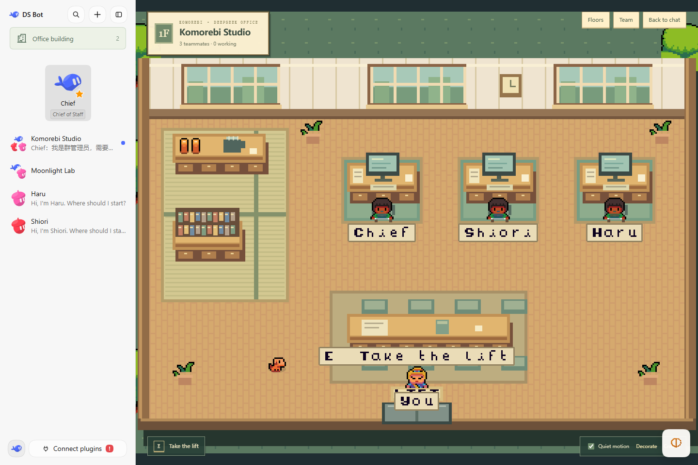

# DeepSeek Office

[English](README.md) | 中文

基于 [DeepSeek-Office](https://github.com/wyx135230/DeepSeek-Office) 和 DS Bot 改造的个人版 [DeepSeek Harness](https://github.com/deepseek-ai/deepseek-harness) 插件。保留原有智能体团队和聊天，同时让你走进偏日式、治愈风的像素办公室。



## 团队有了自己的小楼

- 一个群聊就是一层办公室。大厅目录展示每层的名称、用途、工位数和工作状态。
- 群聊增加或移除成员，办公室同步增加或移除工位；在界面中新建群聊会自动进入它的办公室。
- 默认场景包含障子窗、木地板、榻榻米茶角、会议桌与办公室小狗 Momo。本地打包的 CC0 Ninja Adventure 素材与原创办公家具搭配使用。
- 智能体使用四方向精灵动画，根据真实 Harness 活动返回工位工作，空闲时散步。
- 点击地面绕过家具走动，或使用 WASD / 方向键；按住 Shift 跑步，靠近角色或物件后按 E 互动。镜头跟随玩家。
- 可以在场景中与同事对话、群聊点名或打开私聊；Team 菜单也提供可通过键盘直接进入的对话入口。
- 使用智能体已配置的模型生成并保存像素肖像与服装配色；配色也应用到四方向游戏角色。可以描述新外观重新生成，失败时保留已有或内置角色。
- 支持白天、月夜预设，以及 AI 设计办公室配色与氛围；每层独立保存。
- 没有群聊时不显示办公室入口和场景，单聊保持原版体验；随时可以返回聊天界面。

保留原项目的长期智能体、群聊协作、记忆、模型选择、权限控制、能力库、定时任务和用量统计，详见[插件参考](ds-bot/README.md)。

当前版本先适配电脑端，以键盘和鼠标操作为验收目标；手机适配暂缓。

## 安装本地版本

已在 DSH `0.2.0-rc.2` 上验证。先在 DSH 中配置至少一个模型，用于聊天和 AI 设计。本分支的 npm 包名为 `deepseek-office`；发布个人版本前，请使用本地安装包。

这是原版 `ds-bot` 的替代版本。请在目标 DSH 配置中先禁用或移除原版 `ds-bot` / 旧版 `dsh-bot` 插件，再启用本插件，保留已有团队数据。两个版本沿用同一个内部团队标识和存储格式，不要同时启用。

**DSH Desktop**

1. 打开「插件」→「添加插件」。
2. 填入本次构建 `artifacts/` 目录中 `deepseek-office-0.2.0.tgz` 的绝对路径。
3. 安装并启用；如果提示重启，请完全退出 DSH 再打开。
4. 新建群聊会自动进入办公室；侧栏的 **Office building** 打开大厅。

**DSH Web**

需要 Node.js 22.19 以上和 pnpm，将示例替换为本地安装包的实际路径：

```sh
npx @deepseek-ai/dsh@0.2.0-rc.2 plugin --profile web add "/absolute/path/deepseek-office-0.2.0.tgz"
npx @deepseek-ai/dsh@0.2.0-rc.2 web
```

## AI 设计与初版范围

形象生成通过 Harness 调用该智能体配置的文本模型，返回经过校验的 16 × 24 像素数据和调色板。首次进入办公室时，缺少形象的成员依次生成，保存后重复使用。重新生成角色、AI 设计房间都会额外调用模型并消耗 token。效果取决于模型能力和可用性；失败时保留已有或内置形象，可以手动重试。

当前房间定制支持墙面、地板、点缀配色和昼夜氛围。家具布局与房间结构使用默认预设，为后续 AI 定制家具和布局留下基础。

游戏场景使用本地打包的 Phaser 4.2.1，接入 Arcade Physics、四方向精灵动画、避障寻路和跟随镜头；只在进入办公室时启动，优先使用 WebGL，并支持 Canvas 回退。关闭办公室会销毁游戏和事件监听。Quiet motion 停止环境效果与闲逛，保留玩家操作。插件界面统一为英文，不随 Harness 外壳语言切换；你填写的名称和聊天内容保持原样。

## 开发

源码位于 [ds-bot/](ds-bot/)，设计说明见[办公室 RPG 方案](docs/plans/2026-10-17-office-rpg.md)。

```sh
cd ds-bot
npm ci
npm run harness
npm run build
npm test
node scripts/build-client.mjs --check
npm run lint
npm pack --pack-destination ../artifacts
```

隔离预览使用 `node dev/office-bench.mjs`，默认端口 3106/8806，使用模拟模型和项目内的 `.dsh-test-office/` 数据，不使用日常 DSH 数据。首次使用需要将插件安装进该测试配置，见[开发说明](ds-bot/README.md#office-development)。按 Ctrl+C 停止。

安装包不包含密钥、聊天记录或模型。团队数据保留在目标 DSH 数据目录的 `bot/` 与 `sessions/` 中，卸载插件不会删除。

## 来源与许可

本地修改基于 wyx135230/DeepSeek-Office main 提交 `939a6635830cb5b246e7dd19c67b0e1352ad1c07`，项目源于 [DS Bot](https://github.com/Fei2411/DeepSeek-Bot)。保留原作者版权与 Apache-2.0 许可，见 [LICENSE](LICENSE)、[NOTICE](NOTICE)。

Phaser 与内嵌组件的许可见 [THIRD-PARTY-NOTICES](ds-bot/THIRD-PARTY-NOTICES.txt)。Pixel-Boy / Sparklin Labs 的 [Ninja Adventure](https://github.com/sparklinlabs/superpowers-asset-packs/tree/master/ninja-adventure) 素材采用 CC0 许可，[素材清单](ds-bot/src/client/assets/ninja/SOURCES.md) 固定了来源提交。交互设计参考了 [Pixel Agents](https://github.com/pixel-agents-hq/pixel-agents) 和 [Star Office UI](https://github.com/ringhyacinth/Star-Office-UI) 的公开活动可视化思路，未使用其代码或美术素材。
