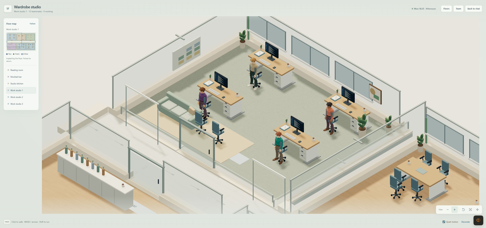

# Rigged office workers — 0.5.1

Verified on Windows, Node 22.23.0, Blender 5.2.2 and the isolated local DSH Web
mock bench. The owner's source GLB and interactive Blender session were untouched.
No production team data, model account, remote asset service or Harness code was
modified. This report supplements the 0.5.0 architecture verification.

## Result

The supplied office worker is now used by the actual office renderer. Twelve
coworkers plus the visitor received thirteen different shirt colors and four
skin colors in the observed roster. Hair, trousers and shoes also vary. Each
automatic wardrobe is retained in this browser's local storage per bot identity;
it is not synchronized between browsers. New identities prefer unused shirts.
There are sixteen available shirt colors; full outfit combinations are checked
for duplicates. Explicit prompted overrides can intentionally match another
person and take precedence over automatic uniqueness.

An integration check caught automatic AI portrait generation replacing all saved
skin colors with the same tone. Fixed: automatic unprompted portraits retain
their own appearance and leave the saved 3D wardrobe alone. A nonempty user
direction still applies its validated avatar colors.

The asset is 1,006,224 bytes with 32,000 triangles, 23 bones, normalized weights
and at most four bone influences per vertex. Eight material regions permit
independent skin, hair, shirt, trousers and shoe colors. Idle, walk, seated,
drink and exercise clips follow existing actor state. Each person owns a mixer,
materials and skeleton; geometry is shared, and material primitives share one
bone texture per person. Book and cup props remain local procedural geometry.

## Checks

- Full test suite: **721 passed, zero failed**.
- Generated client check passed. Lint passed with the same thirteen pre-existing
  warnings and no new warning.
- New tests load the real GLB, check weights/triangle budget/clips, independent
  animation and colors, shared geometry and per-person rig, quiet animation and
  material disposal. Wardrobe tests cover deterministic allocation, retained
  identities, duplicate/corrupt data, denied storage and explicit overrides.
- Actual browser: twelve coworkers; thirteen unique shirts; four skin colors;
  overview, map inspection, zoom, rotation, WASD, reading seat/page panel and
  coworker dialogue. Quiet motion still permits player walking.
- Two close/reopen cycles retained every outfit, released the visible canvas
  and recreated exactly one Three canvas plus the hidden Phaser input canvas.
- Independent source review found no actionable issue. Startup cancellation was
  reviewed in source, not exhaustively stress-tested.

Observed frame counters varied from approximately 39 to 60 FPS at a 2876×1349
game pane and capped 1.5 device pixel ratio; the reopen sample reported 52 FPS.
These are interactive samples, not a sustained performance benchmark. Sharing
one rig per person reduced the observed texture count from 116 to about 25–27.
The browser also emitted extension connection errors and an unattributed
TypeError on full-tab close; this report does not assert zero browser-wide errors.

## Scope

This first wardrobe pass uses the original model's single body, hairstyle and
shirt silhouette. Colors are material assignments, not hand-painted UV textures.
No facial/finger rig, alternate garment geometry, hand IK or polished foot-contact
system is included. The simple clips remain suitable for further pose refinement.
The earlier pixel portrait UI and saved avatar data remain available.

The source build was exercised on the isolated mock profile. The local archive
is audited against the generated client bytes; a separate fresh-profile archive
installation and production-team update are not claimed. No remote publication.

Archive: `artifacts/deepseek-office-0.5.1.tgz`, 62 files, 2,394,833 bytes.
SHA-256: `5c3c668a256b3d6a8f2673e31dba04853cb54ee0d185d0c979897457b6be6127`.
The packaged client matches the source build and embeds the verified GLB. Source
provenance and required notices are included; test profiles, logs and development
dependencies are absent. Test servers, owned browser tabs and the mock profile
were cleaned up after acceptance.

[Whole floor](images/office-wardrobe-overview.png) ·
[Seated reading](images/office-worker-reading.png) ·
[Plan](plans/2026-10-19-character-wardrobe.md)
