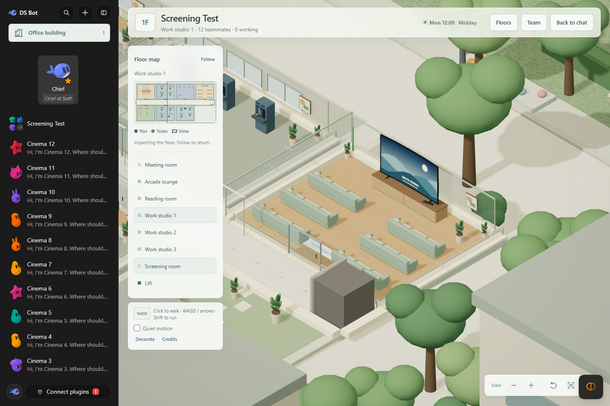
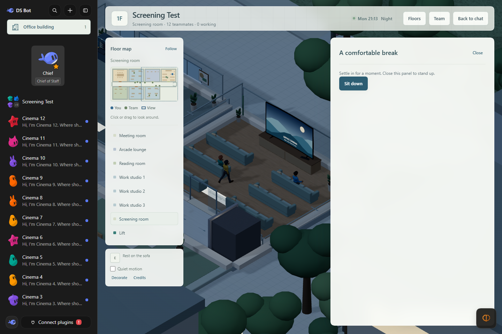
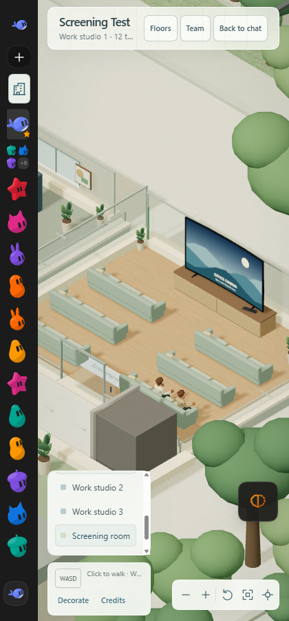

# Screening room verification — 0.6.1

Checked on 2026-10-19 using the isolated `.dsh-test-cinema` profile and local
mock model (ports 3134/8834). No production profile or agent data was used.

- Every group floor and reception has an additional Screening room in the east
  wing. The original six seeded slots, room IDs, furnishings, seated positions
  and material variants match hashes captured before this change.
- Six sofas form three equal rows with two sofas per row. Every sofa has three
  independent seats facing north toward the TV. All 18 aisle approaches, the
  room doorway, original activity stations, desks and translated lift are
  reachable across all tested floor seeds and team sizes, including 0–12 members.
- The owner-supplied TV and remote meshes are embedded locally. Portable PBR
  materials replace unsupported Blender shader nodes. The screen faces the
  seats and shows an original static landscape; video playback is outside this
  change. Source conversion preserves the original files.
- Native mouse clicks took the visitor from a work room to a cinema sofa,
  opened the existing resting panel and seated the visitor facing the TV.
  Closing the panel stood the visitor up in the aisle. Employees independently
  chose the new seats. Unit tests verify three coworkers can reserve three
  positions on one sofa and respect a visitor reservation.
- The visitor walked from the cinema into the relocated lift and travelled
  down to reception. The floor transition completed, doors opened and the
  visitor exited; no new page errors occurred during those interactions.
- Browser lighting was checked at real local night and at noon using the test
  browser's fixed clock. Existing room lighting and materials were not changed.
- The live scene showed two coworkers seated simultaneously in different places
  on the same sofa. At a 420-pixel browser width the game pane measured 365 pixels
  with `scrollWidth === clientWidth`; the room, TV, sofas and camera controls
  remained accessible. The daylight reload produced the browser-extension
  connection warning already seen in previous checks, not a game render failure.
- Independent code review reported no actionable issues and passed 25 relevant
  tests. Full `npm test`: **741 passed**. Generated-client check passed. Lint
  passed with the same 13 existing warnings.
- The final 0.6.1 archive contains 210 files (3,331,282 bytes), including the
  complete LPC licenses, credits and provenance for the embedded artwork. Its generated client
  matches the workspace build, includes the supplied TV geometry and its
  provenance record, and excludes test profiles and logs. SHA-256:
  `e5f2b65e14b797ff9a81bcf840b732e7474babf506593d4eb8ed019ebd71e43e`.

