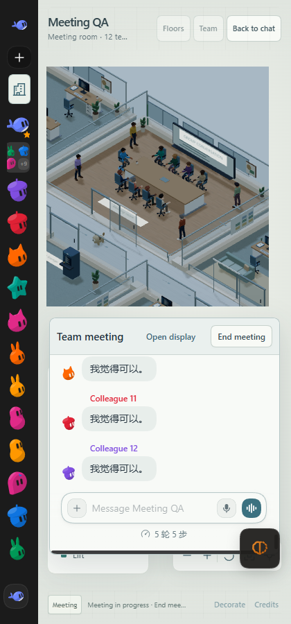
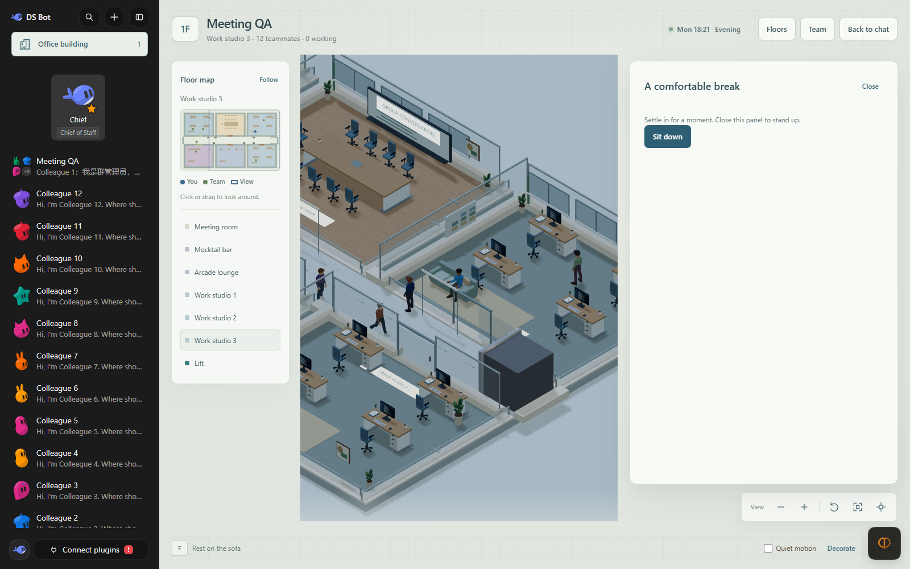

# Meeting rooms and seating — 0.6.0

The meeting is a presentation of the existing group conversation. Bot execution,
group routing, tools, permissions and saved message formats are unchanged.
The renderer never synthesizes an agent reply or starts an independent chat.

## Behavior

- Every group floor has one meeting room and two seeded leisure facilities.
  Reception retains three leisure facilities. Work rooms still expand at members
  five and nine. The current group limit remains twelve members.
- A central long table has a visitor head seat and only the required member
  chairs, up to eight. Each chair has an approach point, seated pose and facing.
  Overflow positions form two aligned pairs around the room. The wall display
  occupies the back wall, opposite the entrance, on either row of the floor.
- Entering prompts **Start a meeting?** once per entry. Enter confirms the focused
  button; **Not now** leaves the room available for walking and display access.
  Employees gather at distinct corridor queue positions. The preceding member
  must enter before the next is released. They then follow collision-aware paths
  to their own seats or standing positions. The visitor takes the head seat.
- The lower conversation borrows a documented Session reference and renders the
  native `conversation.content` factory. It reuses the plugin's existing message
  cells, group progress, full history paging and composer, including attachments,
  mentions and existing interaction cards. While the office is open, a temporary
  `main.conversation` slot shadow releases the original editable root; closing
  the office withdraws the shadow and restores the original conversation.
- Clicking the wall display or pressing E nearby opens the same conversation in
  a centered modal. **Open display** also expands the meeting pane. The shared
  occurrence retains its draft and Session reference while switching layouts.
  The modal focuses its close control, traps Tab and restores focus when closed.
- Recent user and member messages appear above their own models for twelve
  seconds, capped at 72 graphemes. Full text remains in the conversation. Host
  timestamps exclude historical messages, even when an existing round is still
  running when the display opens. Captions never send a second message.
- **End meeting** releases all seat ownership, restores camera zoom and daily
  routines. Floor or membership changes replace the renderer and close meeting
  surfaces. Existing real work state continues independently throughout.
- Removed unused work lounge chairs and automatically generated extra chairs
  around coffee and dining tables. Existing explicit dining seats remain aligned
  with their activity poses. Desk chairs align with their occupants; idle coworkers
  can remain seated at their own workstations. Sofas are preserved and expose two
  independently reservable resting seats. Clicking a sofa selects its own seats;
  **Sit down** rests and closing the activity stands up safely in the aisle.

## Verified locally, 2026-10-19

All browser tests used `.dsh-test-meeting`, local mock ports 3133 / 8833 and an
owned Tabbit test tab. No production profile or live model provider was used.

- `npm test`: **735 passed**, zero failed.
- `node scripts/build-client.mjs --check`: passed.
- `npm run lint`: passed, with the same thirteen existing warnings.
- World regression checks cover every size from zero to twelve, four seeds and
  both reception and group floors. Desks, doors, activity stations and display
  approaches remain reachable. Meeting checks also verify seat correspondence,
  queue reachability, small-group chair counts, sofa seats, model-click mapping,
  Unicode truncation and history / duplicate caption suppression.
- An independent read-only review checked an additional 120 seeds and 1440
  queue-to-seat paths, all reachable, and reviewed lifecycle / focus behavior.
- Twelve-member browser run: thirteen arrivals including the visitor; eight
  seated employees and four standing employees. The recorded room-entry order
  matches the roster exactly. Groups of fewer than eight members create fewer
  chairs instead of empty surplus chairs.
- The actual native composer sent a long `@all` discussion message to the group.
  All twelve members replied through the existing group flow. User captions were
  truncated and member captions appeared above their models; full messages and
  previous history remained in the original conversation.
- Display centering measured zero horizontal and vertical offset from the game
  pane center. Sending from the display, retaining a draft across expansion and
  collapse, modal focus and a single editable composer were verified.
- Actual model clicks opened the wall display and a sofa rest activity. The
  visitor sat at the sofa's registered pose, then stood up in the aisle. Returning
  to the original group chat showed the messages sent in the office.
- Both 760px and 420px windows kept display controls, the composer and the end
  meeting button usable. Narrow layout uses the actual game pane width.

Browser reloads also surfaced errors from installed browser extensions, and the
scene retains existing dog-frame and Three.js shadow deprecation warnings. No
new plugin error was observed in the successful acceptance flows.

## Package

`artifacts/deepseek-office-0.6.0.tgz` contains 65 files and is 2512757 bytes.
Its generated client matches the verified source build byte for byte; both GLBs
are embedded and their provenance / license files are present. The archive
contains no test profile, test logs, development tree or node_modules.

SHA-256: `5fb15469796db0221054f9636e2cee0d30abcbaf7cf8876d434c95057cb539af`.
The owned browser test page was closed, both mock ports stopped and the isolated
profile removed after detaching its directory links.

